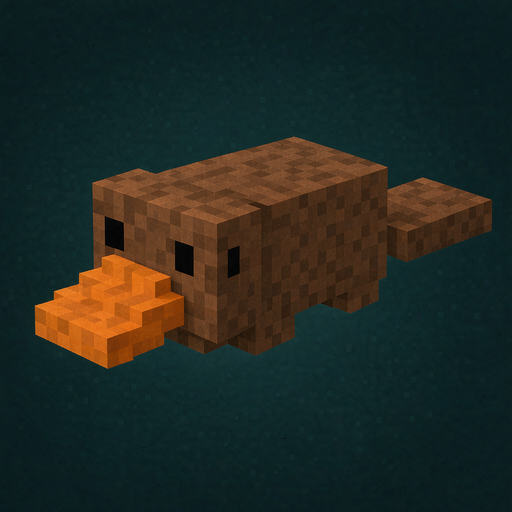

<p align="center">
  
</p>

# 鸭嘴兽启动器（Platypus Launcher）

一个从零写的 Minecraft 启动器。桌面和安卓共用一套界面代码，目标是两端都用得顺手：安卓优先，Windows 与 Linux 跟上。

> **免责声明**
>
> 鸭嘴兽启动器（Platypus Launcher）是一个由第三方开发者制作的非官方 Minecraft 启动器。本项目与 Mojang Studios 及 Microsoft 无任何关联，未获得其授权、认可或赞助。Minecraft 是 Mojang Studios 的注册商标。请支持购买正版游戏。
>
> Platypus Launcher is an unofficial third-party Minecraft launcher. This project is not affiliated with, endorsed by, or sponsored by Mojang Studios or Microsoft. Minecraft is a registered trademark of Mojang Studios. Please support the official game by purchasing it.

## 两条通道

| | 正式版 | 孵化版 |
|---|---|---|
| 中文名 | 鸭嘴兽启动器 | 鸭嘴兽·孵化版 |
| 英文名 | Platypus Launcher | Platypus Preview |
| 版本号 | `1.0.0` 起进位 | `0.x-preview.N` |
| Android applicationId | `io.github.huang404yan.platypus.launcher` | `io.github.huang404yan.platypus.launcher.preview` |
| 命令行 | `platypus-launcher` | `platypus-launcher-preview` |

两个包名不同，所以能装在同一台手机上共存。

**这个仓库里发出去的东西永远是孵化版，也就是开源版。** 正式版只发编译好的安装包，源码不随包走；这里的主干、tag、每一个能下载到的包，都对应孵化版 —— 你在这里看到的就是全部代码，没有一行留在仓库外面。

这也决定了两条线首次启动的规矩不一样：正式版第一次打开要求先登录一个正版账号；孵化版只弹一次说明，讲清想用正版账号得自己准备一个微软应用 ID，然后放行。对着能随手改的源码设卡没有意义，只会挡住想先看看界面的人。

不是 PCL、HMCL、Prism 的分支。这几个项目只在产品形态上参考过，代码一行没抄 —— 见 `CONTRIBUTING.md`。

## 需要什么

| 层 | 选型 |
|---|---|
| 语言 | Kotlin 2.4 |
| 界面 | Compose Multiplatform 1.12 |
| 构建 | Gradle 9.9（wrapper 已带）+ Kotlin DSL |
| JDK | 21 |
| 许可 | Apache-2.0 |

**桌面端**只要 JDK 21：

```bash
./gradlew :app-desktop:run
```

Windows 下用 `gradlew.bat`。首次构建会下大约 300 MB 依赖。

**安卓端**另外要 Android SDK：编译要 Platform 37 与 Build-Tools，编 JNI 层要 NDK `28.2.13676358`。把路径写进 `local.properties` 的 `sdk.dir=`，然后：

```bash
./gradlew :androidApp:assembleDebug
```

没有 NDK 也能编出安装包，只是里面不含启动游戏要用的那几个 `.so`。

**出 Windows 安装包（msi）**还要 WiX 3.14，用 `-PskipWix` 与 `-PwixDir=<WiX 目录>` 指过去。只出免安装 zip 就不用管它。

## 目录

```
core/            纯 Kotlin，不依赖界面，也不依赖 Android
  instance/      实例模型（实例 = 自包含目录）
  download/      多源下载、并发、续传、校验
  runtime/       Java 运行时探测、推荐与下载
  auth/          离线 / 微软 / 外置登录
  launch/        启动计划、参数翻译、命令拼装
  modpack/       整合包导入导出
  server/        服务端安装与控制台
ui/              Compose Multiplatform，桌面与安卓共用
app-desktop/     桌面端入口
androidApp/      安卓端入口
```

`GameRuntime` 是两端的分界线：桌面实现是起一个 java 进程，安卓实现是应用内 JVM 加图形转译。上层只认这个接口，所以模组、存档、整合包那些页面两端是同一份代码。

安卓端的应用内 JVM 已经接到 `JNI_CreateJavaVM`，但真机上还起不来：Android 10 起不允许从可写目录 `dlopen` 原生库，而运行时一定解在可写目录里。图形转译层也还没接。这条线目前能用到「进游戏之前的全部准备」（选运行时、拼参数、跑自检）。

## 下载

编译好的包不在这个仓库里，走 [Releases](https://github.com/huang404yan/Platypus-Launcher/releases) 的附件。仓库只放源码与构建必需的文件 —— 二进制进了历史就删不掉，只会把仓库撑大。

正版登录要用一串微软给的应用 ID。孵化版不内置：任何随安装包发出去的 ID 都等于让所有下载者共用一份别人名下的应用注册，被限流、被收紧、被认定滥用，都不是拿到包的人能处理的。所以第一次打开会告诉你去哪儿申请一个自己的（免费，三分钟），之后一直用。正式版由构建方自己注入。

## 许可与贡献

Apache-2.0，见 `LICENSE` 与 `NOTICE`。改动之前请先看 `CONTRIBUTING.md`，里面最要紧的一条是不抄 GPL 项目的代码。

非官方项目，与 Mojang Studios 及 Microsoft 无关联。
